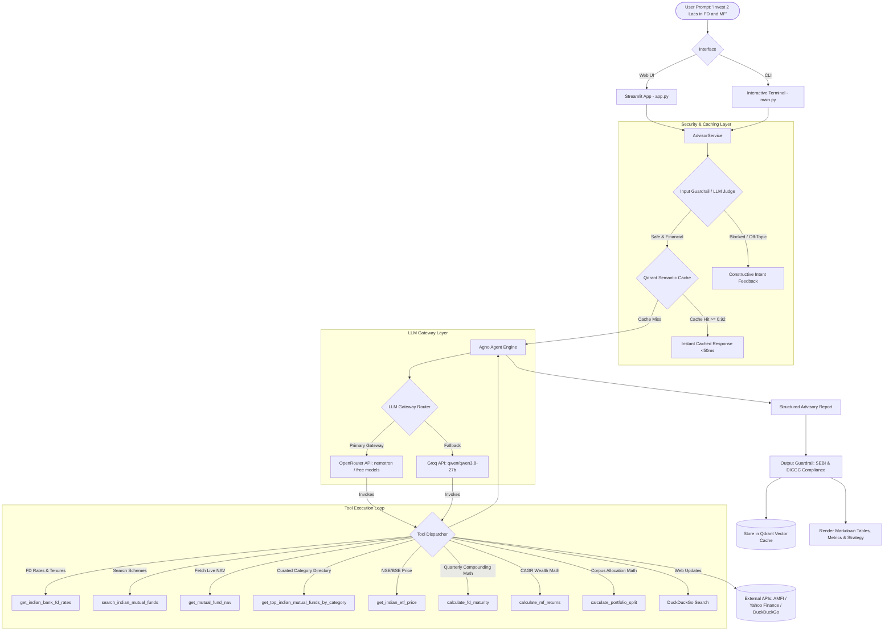

# My-Invest: Indian Bank FD & Mutual Fund Investment Advisor

[](https://www.python.org/)
[](https://github.com/agno-agi/agno)
[](https://openrouter.ai/)
[](https://groq.com/)
[](https://streamlit.io/)
[](https://www.mfapi.in/)

An intelligent, multi-tool AI investment research assistant tailored specifically for Indian retail investors. 

Given any natural-language investment goal (e.g., *"I want to invest 2 lacs inr in Indian bank fixed deposits and in Indian mutual funds for 3 years"*), **My-Invest** automatically parses investor intent, gathers real-time bank FD interest rates, queries official AMFI mutual fund Net Asset Values (NAVs), tracks Indian market ETFs, computes mathematical compound returns, and synthesizes a balanced, tax-efficient portfolio strategy.

---

## Table of Contents
- [Key Features](#key-features)
- [Technology Stack](#technology-stack)
- [System Architecture & Data Flow](#system-architecture--data-flow)
- [Agent Tools Reference](#agent-tools-reference)
- [Walkthrough Example (End-to-End)](#walkthrough-example-end-to-end)
- [Project Structure](#project-structure)
- [Installation & Getting Started](#installation--getting-started)
- [Configuration & Environment Variables](#configuration--environment-variables)
- [Testing](#testing)
- [Compliance & Disclaimer](#compliance--disclaimer)

---

## Key Features

1. **Intelligent Natural Language Advisory**
   - Seamlessly extracts investment corpus (in ₹, Lakhs, Crores), investment horizon (short/medium/long-term), and risk profile (Conservative, Moderate, Aggressive).
   - Generates structured, actionable allocation plans with markdown summaries, allocation tables, and execution steps.

2. **Live Indian Bank FD Benchmarking & Safety Guardrails**
   - Tracks FD interest rates across:
     - **Public Sector Banks**: State Bank of India (SBI), Punjab National Bank (PNB), Bank of Baroda (BOB), Canara Bank.
     - **Leading Private Banks**: HDFC Bank, ICICI Bank, Axis Bank, Kotak Mahindra Bank.
     - **High-Yield Small Finance Banks**: Unity SFB (up to 9.00%), Suryoday SFB, AU Small Finance Bank, Equitas SFB.
     - **Government Small Savings**: Post Office Term Deposits (POTD), Senior Citizen Savings Scheme (SCSS).
   - Emphasizes **DICGC (Deposit Insurance and Credit Guarantee Corporation)** safety limits (covers up to ₹5,00,000 principal + interest per depositor per bank).
   - Accounts for senior citizen additional interest premiums (+0.50% p.a.).

3. **Official AMFI Mutual Fund Lookup & Real-Time NAVs**
   - Direct integration with AMFI database (`api.mfapi.in`) for instant search across thousands of Indian mutual funds.
   - Fetches live NAV, scheme category, fund house, and NAV dates via unique AMFI scheme codes.
   - Strictly prioritizes **Direct-Growth plans** (zero distributor commission), saving 0.5% – 1.5% in expense ratios annually.
   - Curated directory for core categories: Flexi Cap, Large Cap Index, Balanced Advantage / Hybrid, Liquid & Corporate Debt, and Mid/Small Cap.

4. **Live NSE / BSE ETF Market Tracking**
   - Live market pricing via Yahoo Finance for benchmark ETFs such as `NIFTYBEES.NS` (Nifty 50), `GOLDBEES.NS` (Physical Gold), `JUNIORBEES.NS` (Nifty Next 50), and `BANKBEES.NS`.

5. **Precise Mathematical Financial Calculators**
   - **Quarterly Compounded FD Calculator**: Implements the Indian banking standard $A = P \times (1 + r/n)^{nt}$ where $n=4$.
   - **Mutual Fund CAGR Projection**: Computes compounding growth and net capital gains $A = P \times (1 + r)^t$.
   - **Portfolio Corpus Splitter**: Accurately distributes capital across fixed income and equity instruments.

6. **Indian Tax & Regulatory Intelligence**
   - Compares FD interest taxation (taxed at investor's marginal income tax slab rate, Section 80TTB deduction for seniors) against Mutual Fund taxation (Equity LTCG @ 12.5% on gains exceeding ₹1.25 Lakh; Debt MF taxed at slab rates).

7. **Real-Time LLM & Tool Execution Telemetry**
   - Live user-facing telemetry cards at the bottom of the dashboard tracking LLM inference counts, active gateway provider and model identifier, tokens processed, latency, and tools executed per query.
   - Interactive badge display of all tools executed (e.g. `get_indian_bank_fd_rates`, `search_indian_mutual_funds`, `calculate_fd_maturity`) plus an audit history log of all queries run in the session.

8. **Unified LLM Gateway Architecture (OpenRouter Tier 1)**
   - Integrates **OpenRouter API Gateway** (`https://openrouter.ai/api/v1`) as the centralized LLM gateway layer.
   - Provides out-of-the-box access to top free high-parameter models (e.g., `nvidia/nemotron-3-super-120b-a12b:free`, `nvidia/nemotron-3.5-lightning:free`).
   - Built-in multi-model fallback chain: If the primary model experiences provider rate limits, requests automatically route to secondary fallback models or direct **Groq** inference.

9. **High-Performance Tier-1 TTL Tool Caching**
   - Built-in thread-safe TTL & LRU caching layer across financial tools to eliminate 90%+ of redundant network roundtrips.
   - Bank FD benchmarks & DuckDuckGo searches: cached for 24 hours.
   - AMFI NAV lookups: cached for 12 hours (reflecting AMFI's daily NAV publishing schedule).
   - AMFI fund searches: cached for 24 hours.
   - Cached calls resolve in **< 1ms** with live hit/miss metrics visible in the telemetry panel.

10. **Qdrant Vector Database Semantic Caching (Tier 2)**
   - Integrates **Qdrant Cloud** vector database with **FastEmbed** (`BAAI/bge-small-en-v1.5`, 384-dim embeddings) to cache full advisory blueprints for semantically equivalent queries.
   - Cosine similarity matching (default threshold $\ge 0.92$): Rephrased prompts with the same investment goal are returned immediately in **< 50ms**, completely consuming **0 LLM calls** and **0 tool calls**.
   - Direct connection to live Qdrant Cloud cluster with seamless configuration support for both local `.env` and Streamlit Community Cloud (`st.secrets`).

11. **Autonomous LLM-as-a-Judge & Production Guardrails**
    - **LLM-as-a-Judge (Semantic Intent & Security)**: Uses a dedicated model operating in structured JSON mode (`temperature=0.0`) or Prompt Guard classifier to semantically evaluate whether prompts belong to Indian wealth planning or represent off-topic requests / jailbreaks.
    - **Constructive Intent Explanations**: When rejecting queries (e.g. *"what is time now?"*, cricket scores, game coding), it extracts the exact reasoning and steers the user with contextual Indian investment examples.
    - **Zero Cache Pollution**: Rejections bypass agent execution entirely, consuming **0 advisor tokens**, **0 tool hops**, and writing **zero unwanted points to Qdrant Cloud**.
    - **Output Guardrails (Compliance & Safety)**: Automatically audits outputs to enforce mandatory **SEBI market risk notices** and **DICGC deposit insurance rules**, while sanitizing unrealistic return guarantees on market-linked assets.
    - **Deterministic Safety Net Fallback**: If the judge model is ever unreachable, the engine gracefully falls back to deterministic rule-based checks with zero application downtime.

---

## Technology Stack

| Layer | Technology | Purpose |
|---|---|---|
| **Agentic Framework** | [Agno](https://github.com/agno-agi/agno) (v3.0+) | Multi-tool autonomous agent orchestration and tool execution runtime |
| **LLM Gateway (Tier 1)** | [OpenRouter](https://openrouter.ai/) (`https://openrouter.ai/api/v1`) | Unified OpenAI-compatible gateway with multi-model routing & free models |
| **Direct LLM Fallback** | [Groq](https://groq.com/) (`qwen/qwen3.8-27b`) | Direct ultra-fast inference and specialized Prompt Guard classification |
| **Vector Database (Tier 2)** | [Qdrant](https://qdrant.tech/) Cloud | Semantic advisory caching via cosine similarity embeddings |
| **Embedding Engine** | [FastEmbed](https://github.com/qdrant/fastembed) (`bge-small-en-v1.5`) | Ultra-fast ONNX-based local query embedding generation (384-dim) |
| **User Interface** | [Streamlit](https://streamlit.io/) (v1.40+) | Interactive multi-tab web application with metrics, live tables, and calculators |
| **Mutual Fund Data** | [AMFI Open API](https://www.mfapi.in/) | Real-time AMFI search and live NAV resolution (`api.mfapi.in`) |
| **Market Data** | [yfinance](https://github.com/ranaroussi/yfinance) | Real-time NSE/BSE stock and ETF prices (`.NS`, `.BO`) |
| **Web Search** | [DuckDuckGo Search](https://github.com/deedy5/duckduckgo_search) | Live search for promotional bank FD interest rates, special tenures, and festive offers |
| **Data & Configuration** | [Pydantic Settings](https://docs.pydantic.dev/) & [Pandas](https://pandas.pydata.org/) | Strongly-typed environment configuration and tabular data presentation |
| **Testing** | [pytest](https://pytest.org/) | Unit and integration testing for all financial tools and services |

---

## System Architecture & Data Flow



---

## Agent Tools Reference

All tools are located in `src/my_invest/tools/` and registered with the Agno agent:

| Tool Name | Module | Parameters | Description |
|---|---|---|---|
| `get_indian_bank_fd_rates` | `bank_fd_tool.py` | `query: str` | Retrieves verified benchmark FD interest rates across PSU, Private, and Small Finance Banks, plus live DuckDuckGo query for promotional tenures. |
| `search_indian_mutual_funds` | `mutual_fund_tool.py` | `query: str` | Queries official AMFI API for fund keywords (e.g., `'Parag Parikh'`, `'Nifty 50'`) and prioritizes Direct-Growth schemes with scheme codes. |
| `get_mutual_fund_nav` | `mutual_fund_tool.py` | `scheme_code: int` | Fetches the latest published official NAV, fund house name, scheme category, and date directly from AMFI. |
| `get_top_indian_mutual_funds_by_category` | `mutual_fund_tool.py` | `category: str` | Returns curated high-performing Direct Growth funds across Flexi Cap, Large Cap Index, Hybrid, Debt, and Mid/Small Cap. |
| `get_indian_etf_price` | `mutual_fund_tool.py` | `ticker: str` | Queries Yahoo Finance for Indian ETFs listed on NSE/BSE (e.g., `NIFTYBEES.NS`, `GOLDBEES.NS`). |
| `calculate_fd_maturity` | `calculator_tool.py` | `principal_inr, annual_rate_pct, tenure_years, compounding_frequency=4` | Computes maturity value, interest earned, and effective annual yield using quarterly compounding: $A = P(1 + r/4)^{4t}$. |
| `calculate_mf_returns` | `calculator_tool.py` | `lumpsum_inr, expected_cagr_pct, tenure_years` | Computes estimated capital gains and future wealth value based on expected CAGR: $A = P(1 + r)^t$. |
| `calculate_portfolio_split` | `calculator_tool.py` | `total_corpus_inr, fd_ratio_pct=50.0, mf_ratio_pct=50.0` | Computes the exact rupee allocation between Fixed Deposits and Mutual Funds. |
| `DuckDuckGoTools` | Agno Builtin | `query: str` | Searches web for special festive bank FD schemes or sudden rate changes. |
| `YFinanceTools` | Agno Builtin | `symbol: str` | Retrieves live asset fundamentals and market quotes. |

---

## Walkthrough Example (End-to-End)

### User Prompt:
> *"I want to invest 2 lacs inr in Indian bank fixed deposits and in Indian mutual funds for 3 years with balanced risk."*

### Step 1: Intent & Entity Parsing
- **Total Corpus**: ₹2,00,000 INR
- **Horizon**: 3 years (Medium Term)
- **Risk Tolerance**: Balanced / Moderate
- **Target Assets**: Bank FDs + Diversified Mutual Funds

### Step 2: Agent Tool Invocation Sequence
1. `calculate_portfolio_split(total_corpus_inr=200000, fd_ratio_pct=50, mf_ratio_pct=50)`  
   $\rightarrow$ ₹1,00,000 to Bank FDs, ₹1,00,000 to Mutual Funds.
2. `get_indian_bank_fd_rates("3 year FD rates")`  
   $\rightarrow$ SBI @ 7.00%, HDFC @ 7.00%, AU SFB @ 7.50%, Unity SFB @ 9.00% (with DICGC ₹5L cover check).
3. `get_top_indian_mutual_funds_by_category("hybrid")` and `get_top_indian_mutual_funds_by_category("flexi cap")`  
   $\rightarrow$ Identifies *HDFC Balanced Advantage Fund* (Scheme Code `118968`) and *Parag Parikh Flexi Cap Fund* (Scheme Code `122639`).
4. `get_mutual_fund_nav(scheme_code=118968)` and `get_mutual_fund_nav(scheme_code=122639)`  
   $\rightarrow$ Fetches latest AMFI NAV values and verification dates.
5. `calculate_fd_maturity(principal_inr=100000, annual_rate_pct=7.25, tenure_years=3)`  
   $\rightarrow$ Maturity Value: **₹1,24,055.21** (Interest: ₹24,055.21, Yield: 7.45%).
6. `calculate_mf_returns(lumpsum_inr=100000, expected_cagr_pct=12.0, tenure_years=3)`  
   $\rightarrow$ Projected Future Value: **₹1,40,492.80** (Estimated Capital Gain: ₹40,492.80).

### Step 3: Final Synthesized Advisory Output
The agent outputs a professional advisory dossier:
- **Executive Summary Table**: Rupee breakdown (₹1,00,000 FD + ₹1,00,000 MF), expected blend return (~9.8% annualized), net maturity projection.
- **Part A: Bank FD Allocation**: Recommends splitting between a Tier-1 Bank (e.g. SBI/HDFC at 7.0%) for highest stability and a leading Small Finance Bank (AU SFB at 7.50%) under the ₹5 Lakh DICGC guarantee limit.
- **Part B: Mutual Fund Strategy**: Direct-Growth allocation across *Parag Parikh Flexi Cap Direct Growth* (60%) and *HDFC Balanced Advantage Direct Growth* (40%) with live NAV details.
- **Taxation Implications**: Details on TDS at 10% on FD interest exceeding ₹40,000 per year vs Equity LTCG tax at 12.5% for gains above ₹1.25 Lakh.
- **Actionable Execution Checklist**: Net banking steps for FD creation, and direct investment portals (MF Central, AMC Direct) for zero-commission investing.

---

## Project Structure

```
My-Invest/
├── .env.example             # Template for API keys and configuration
├── .env                     # Local environment settings (GROQ_API_KEY)
├── app.py                   # Streamlit web application with multi-tab UI
├── main.py                  # Interactive CLI assistant
├── pyproject.toml           # Project metadata and dependencies
├── requirements.txt         # Pinned production dependencies
├── README.md                # Comprehensive project documentation
│
├── src/
│   └── my_invest/
│       ├── __init__.py
│       ├── settings.py      # Pydantic Settings & environment manager
│       ├── advisor_service.py # Advisor orchestration service
│       │
│       ├── agents/
│       │   ├── __init__.py
│       │   └── advisor_agent.py # Agno Agent configuration & system prompt
│       │
│       └── tools/
│           ├── __init__.py
│           ├── bank_fd_tool.py    # FD rate benchmarks & DuckDuckGo search
│           ├── mutual_fund_tool.py# AMFI API integration & ETF tracker
│           └── calculator_tool.py # Compound interest & CAGR calculations
│
└── tests/
    ├── conftest.py          # Pytest path and environment fixtures
    └── test_tools.py        # Automated test suite for financial tools
```

---

## Installation & Getting Started

### 1. Prerequisites
- **Python 3.11+** installed on your system.
- An **OpenRouter API Key** (free from [openrouter.ai](https://openrouter.ai/keys)) or a **Groq Cloud API Key** (from [Groq Console](https://console.groq.com/keys)).

### 2. Clone and Setup Environment
```bash
# Navigate to the project root
cd My-Invest

# Create virtual environment
python -m venv .venv

# Activate virtual environment
# Windows PowerShell:
.venv\Scripts\Activate.ps1
# macOS/Linux:
source .venv/bin/activate

# Install dependencies
pip install -r requirements.txt
```

### 3. Configure API Key
Create a `.env` file in the project root:
```env
# Tier 1: LLM Gateway Configuration (OpenRouter)
LLM_GATEWAY_URL=https://openrouter.ai/api/v1
LLM_GATEWAY_API_KEY=sk-or-v1-your_openrouter_api_key_here
LLM_GATEWAY_MODEL=qwen/qwen3.6-27b

# Direct Groq LLM Configuration (Fallback / Dedicated Guardrail)
GROQ_API_KEY=gsk_your_actual_groq_api_key_here
GROQ_MODEL=qwen/qwen3.8-27b
GUARDRAIL_MODEL=meta-llama/Llama-Prompt-Guard-2-22M

# Tier 2: Qdrant Cloud Vector Database Configuration (Semantic Caching)
QDRANT_URL=https://your-cluster-id.region.gcp.cloud.qdrant.io:6333
QDRANT_API_KEY=your_qdrant_api_key_here
QDRANT_COLLECTION=investment_advisory_cache
SEMANTIC_CACHE_ENABLED=true
SEMANTIC_CACHE_THRESHOLD=0.92
```

### 4. Running the Applications

#### Option A: Run the Streamlit Web Application
```bash
streamlit run app.py
```
*Open your browser at `http://localhost:8501` to explore:*
- **AI Portfolio Advisor Tab**: Run prompts or choose ready-made templates.
- **Live FD Rate Explorer Tab**: View and filter interest rates across bank tiers.
- **Indian Mutual Fund NAVs Tab**: Search official AMFI database by name or scheme code.
- **Return & Maturity Calculator Tab**: Interactive sliders for quarterly compounded FD & CAGR calculations.

#### Option B: Run the Interactive Terminal CLI
```bash
python main.py
```
*Type your investment query directly into the interactive terminal prompt.*

#### Option C: Inspect & Query Qdrant Cloud Vectors
Inspect and verify cached embeddings, similarity scores, and prompts directly in your live Qdrant Cloud cluster:
```bash
# View collection health & total cached blueprints
python inspect_qdrant.py --stats

# List all stored prompts and payloads
python inspect_qdrant.py --list --limit 10

# Test a semantic similarity query against your cloud collection
python inspect_qdrant.py --query "I want to invest 2 lacs in bank FD and mutual funds for 3 years"
```

---

## Configuration & Environment Variables

All settings are managed via [`pydantic-settings`](https://docs.pydantic.dev/latest/concepts/pydantic_settings/) in `src/my_invest/settings.py`. On local environments, configurations are read from `.env`. On **Streamlit Community Cloud**, settings are read seamlessly from Streamlit Secrets (`st.secrets`):

| Variable Name | Default Value | Description |
|---|---|---|
| `LLM_GATEWAY_URL` | `https://openrouter.ai/api/v1` | OpenRouter or OpenAI-compatible LLM Gateway endpoint |
| `LLM_GATEWAY_API_KEY` | *None* | OpenRouter Gateway API authentication key (`sk-or-v1-...`) |
| `LLM_GATEWAY_MODEL` | `qwen/qwen3.6-27b` | Primary model identifier on gateway (e.g. `qwen/qwen3.6-27b`) |
| `LLM_TEMPERATURE` | `0.2` | Model sampling temperature (0.0 - 1.0; 0.1-0.3 recommended for factual finance) |
| `GROQ_API_KEY` | *None* | Groq Cloud API authentication key (fallback inference & prompt-guard) |
| `GROQ_MODEL` | `qwen/qwen3.8-27b` | Direct Groq LLM model identifier |
| `GUARDRAIL_MODEL` | `meta-llama/Llama-Prompt-Guard-2-22M` | Dedicated security classifier model for prompt injection & jailbreak |
| `DEFAULT_INVESTMENT_AMOUNT` | `200000.0` | Default seed corpus amount in INR (₹2,00,000) |
| `AGENT_TOOL_CALL_LIMIT` | `8` | Maximum tool execution hops per advisory query |
| `MAX_TOKENS` | `1500` | Maximum token limit for LLM generation |
| `LOG_LEVEL` | `INFO` | Application log verbosity (`DEBUG`, `INFO`, `WARNING`) |
| `QDRANT_URL` | *None (Cloud URL)* | Qdrant Cloud cluster endpoint URL (e.g. `https://xyz.cloud.qdrant.io:6333`) |
| `QDRANT_API_KEY` | *None* | Qdrant Cloud authentication API key |
| `QDRANT_COLLECTION` | `investment_advisory_cache` | Name of the Qdrant vector collection for semantic cache |
| `SEMANTIC_CACHE_ENABLED` | `true` | Enables or disables Tier-2 Qdrant semantic caching |
| `SEMANTIC_CACHE_THRESHOLD` | `0.92` | Cosine similarity threshold for cache hits (0.85 – 0.98) |

### Streamlit Community Cloud Deployment
When deploying to Streamlit Cloud, add the following to **App Settings $\rightarrow$ Secrets**:
```toml
LLM_GATEWAY_URL = "https://openrouter.ai/api/v1"
LLM_GATEWAY_API_KEY = "sk-or-v1-..."
LLM_GATEWAY_MODEL = "qwen/qwen3.6-27b"
LLM_TEMPERATURE = 0.2

GROQ_API_KEY = "gsk_..."
GROQ_MODEL = "qwen/qwen3.8-27b"
GUARDRAIL_MODEL = "meta-llama/Llama-Prompt-Guard-2-22M"

QDRANT_URL = "https://your-cluster.cloud.qdrant.io:6333"
QDRANT_API_KEY = "your_qdrant_api_key_here"
QDRANT_COLLECTION = "investment_advisory_cache"
SEMANTIC_CACHE_ENABLED = "true"
SEMANTIC_CACHE_THRESHOLD = "0.92"
```

---

## Testing

Run the automated test suite using `pytest`:
```bash
pytest -v
```

The test suite validates:
- Benchmark FD data structures across PSBs, Private, and Small Finance Banks.
- AMFI API search endpoint functionality and scheme resolution.
- Live AMFI NAV retrieval with valid response schemas.
- Mathematical precision for quarterly compounding FD maturity and CAGR calculations.
- Portfolio split mathematics.

---

## Compliance & Disclaimer

> **Important Regulatory Notice**:  
> **My-Invest** is an educational and informational AI research tool. It does not constitute registered financial advice under SEBI (Investment Advisers) Regulations, 2013.  
> - **Mutual Funds**: Mutual fund investments are subject to market risks. Please read all scheme-related documents carefully before investing.  
> - **Bank Fixed Deposits**: Deposit returns depend on the issuing bank's solvency and prevailing RBI guidelines. Bank deposits are insured up to ₹5,00,000 per bank per depositor by the DICGC.  
> - Always consult a SEBI-registered investment advisor (RIA) or certified financial planner before executing major financial decisions.
